# Plotting

The figures of `pkpdutils.plot` are charts of [sbmlsim-core](https://matthiaskoenig.github.io/sbmlsim-core/chart/) (`sbmlsim_core.chart.Chart`), drawn by its renderer, without matplotlib. Every function returns the `Chart` it drew, so a script saves it by the suffix of its path (`chart.save("name.svg")`, SVG by default, PNG with `dpi=` and the JSON of its spec) and a notebook displays it. Colors and markers come from a `PlotStyle`.

Every signature has the same shape, `f(data, *, <options>, chart=None, row=0, column=0, style=DEFAULT_STYLE)`: the data first and positionally, every option as a keyword, and the chart and `style` last. Without `chart` a function draws a chart of its own; with one it draws its panels into the cells of the grid of that chart from `(row, column)` on, so that several figures share one chart (`new_chart(width, height, rows=..., columns=...)`, the size in inches and the fonts of the package). A figure of several panels takes as many cells (`plot_nca` two along the row and a third for the parameter table, `plot_fit` two down the column, `plot_nca_grid` one per sample), and a logarithmic axis is `log_x` or `log_y`, with plain tick labels (`10`, `100`) rather than powers of ten; an axis without a positive value stays linear and says so in a debug log. `draw_nca_panel` draws a single NCA panel into a cell and returns the `ChartPlot`, for a figure the caller lays out itself.

## The data of this page

The snippet below builds the `batch`, the `result` and the single curve `tc` every snippet of this page draws, and writes the two figures of the next two sections; it is the dose escalation of `examples/nca_batch.py`. The fit, the bioequivalence and the meta-analysis figures further down use the results of [Curve fitting](fitting.md) and [Statistics](statistics.md), whose pages build them the same way.

```python
import numpy as np

from pkpdutils import Route, Timecourses, nca
from pkpdutils.plot import plot_mean_timecourse, plot_nca_grid

# a dose escalation of four individuals at three dose levels
rng = np.random.default_rng(1)
time = np.array([0.25, 0.5, 1, 2, 3, 4, 6, 8, 12, 24])
doses = np.array([50.0, 100.0, 200.0])
ke = rng.uniform(0.15, 0.3, size=4)
ka = rng.uniform(1.0, 3.0, size=4)
values = np.stack(
    [
        np.stack(
            [
                d
                / 40
                * ka[j]
                / (ka[j] - ke[j])
                * (np.exp(-ke[j] * time) - np.exp(-ka[j] * time))
                * rng.lognormal(0, 0.05, size=time.size)
                for j in range(4)
            ]
        )
        for d in doses
    ]
)
batch = Timecourses.from_arrays(
    time,
    values,
    time_unit="hr",
    unit="mg/l",
    dims=("dose", "individual"),
    coords={"dose": doses, "individual": ["s1", "s2", "s3", "s4"]},
    dose={"amount": np.broadcast_to(doses[:, None], (3, 4)), "unit": "mg"},
    route=Route.ORAL,
    substance="drug",
)
result = nca(batch)
tc = batch.sel(dose=50.0, individual="s1")  # one curve of the batch

plot_mean_timecourse(batch, by="dose").save("mean_curves.svg")
plot_nca_grid(batch, result, ncols=4).save("nca_grid.svg")
```

## Timecourses

`plot_mean_timecourse` is the concentration-time figure of a study report: the mean of every group at every time point, the band of its spread around it, the individual curves faint behind both, on a linear and a semi-logarithmic panel. `by` names the coordinate the groups come from (a dose level, a treatment, an arm) and `spread` the statistic of the band, `"sd"`, `"se"` or `None`; the reduction is `Timecourses.groupby` and `Timecourses.mean`, so the band is the scatter of the curves. The legend is drawn once, on the first panel, and names every group with the number of subjects behind its mean.

```python
from pkpdutils.plot import plot_mean_timecourse

chart = plot_mean_timecourse(batch, by="dose", spread="sd")
chart = plot_mean_timecourse(
    batch, by="dose", spread="se", individuals=False, panels=("log",)
)
chart.save("mean_curves.svg")
```

`plot_mean_timecourse(batch, by="dose")` of the dose escalation of `examples/nca_batch.py`:

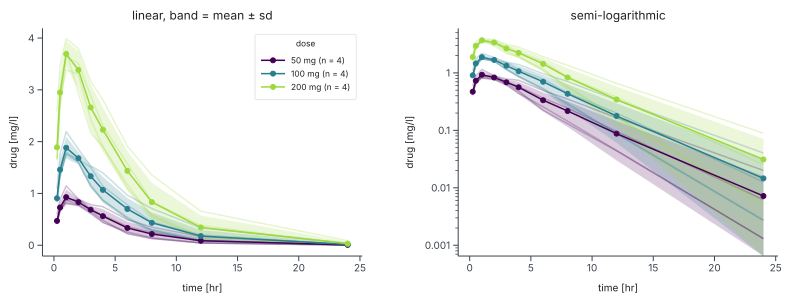

`plot_study_curves` is the figure pair ICH M13A[^ich_m13a] asks a study report for: the concentration-time profile of every subject on a linear and on a semi-logarithmic scale, drawn against the times the samples were taken at, and the mean profile of every group on both scales, drawn against the nominal times of the protocol. A mean over the subjects only exists on the schedule the study sampled by, since no two subjects are sampled at the same minute; the four panels are `plot_timecourse` in the first row and `plot_mean_timecourse` in the second, so `by` colors the groups the same way in all of them. The nominal times come from the variable `nominal_time` of the batch when it carries one (`Timecourses.from_arrays(nominal_time=...)`, `from_dataframe(nominal_time=...)`), else from `nominal_times`, which maps every actual time to the nearest scheduled one, and else the times of the batch are taken as nominal, which is the right answer for a simulation or a mean curve of a publication. `log_y_panels=False` draws the two linear panels alone.

```python
from pkpdutils.plot import plot_study_curves

chart = plot_study_curves(batch, by="dose")  # four panels, one color per dose
chart = plot_study_curves(batch, by="dose", nominal_times=time)  # the schedule
chart = plot_study_curves(batch, log_y_panels=False)  # the linear pair alone
chart.save("study_curves.svg")
```

`plot_study_curves(study, by="dose")` of the dose escalation of `examples/nca_batch.py`, whose samples were taken a few minutes beside the schedule:

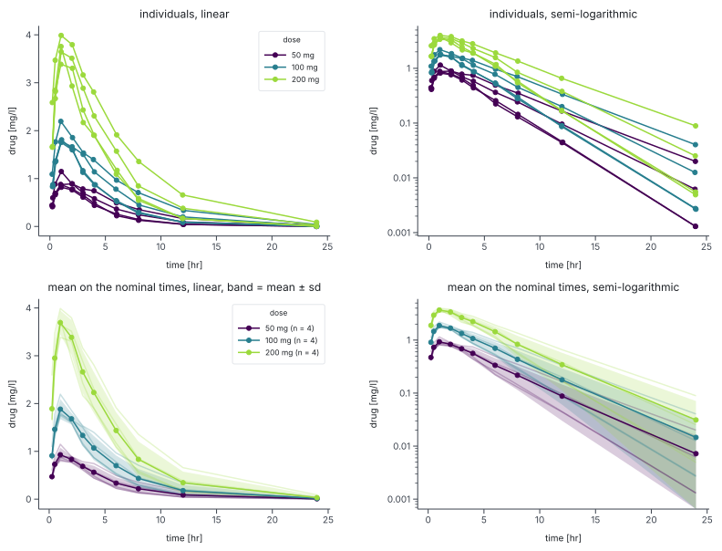

`plot_timecourse` draws one curve or every curve of a batch, with the standard error (or the standard deviation) as error bars when present. Without `by` every sample gets its own color and its label in the legend; `by` names a coordinate and gives one color and one legend entry per group, `facet` a coordinate drawn as one panel per value, and `max_legend` (12 by default) the number of entries above which no legend is drawn at all, since it would cover the figure rather than explain it. A faceted figure takes one cell per value along the row; the panels scale on their own data.

```python
from pkpdutils.plot import plot_timecourse

chart = plot_timecourse(batch, log_y=True, by="dose")  # one color per dose
chart = plot_timecourse(tc)  # the single curve of the batch
chart.save("curves.svg")
```

`facet` needs a second coordinate, `plot_timecourse(batch, facet="dose", by="sex")` with a `sex` along the individual dimension.

`plot_timecourse` of a single curve and of a batch (`examples/timecourses.py`), and of a dose scan with `by` (`examples/nca_from_sbmlsim.py`):

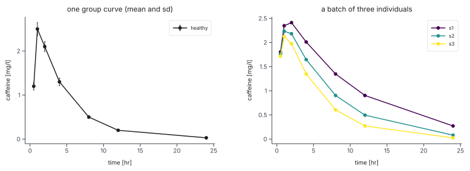

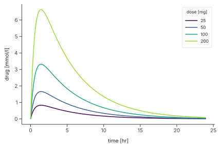

A curve carrying a dosing protocol of more than one dose gets a thin dotted vertical line at every dose time (`style.dose_color`, default `"gray"`) and an infusion the shaded window from the dose time to the end of the infusion; a batch draws no dose markers, since its curves may carry different protocols, while `plot_mean_timecourse` draws them for the protocol of the group.

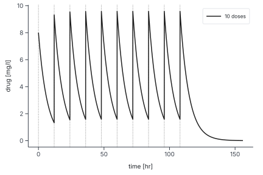

## NCA diagnostics

`plot_nca` shows what the analysis did with one curve, on a linear and a logarithmic axis, and reads as the report of that analysis: the data with their `sd` or `se` as error bars (`spread`), the area to \(t_\mathrm{last}\), the extrapolated tail, the terminal regression line with the points it used and its confidence band (`ci_level`, 95 % by default: the band of the regression of \(\ln c\) on \(t\), widening away from the centre of the window, so that the uncertainty of the extrapolated tail is visible), \(C_\mathrm{max}\)/\(t_\mathrm{max}\) with their guide lines, \(C_0\) for a bolus, and the flags in the title. The values are written on the plot (`annotate`): the peak, the last point, \(\lambda_z\) with the half-life and its interval and the number of regression points. A third panel lists the `parameters` (`PANEL_PARAMETERS` by default: peak, exposure, half-life, clearance, volume, mean residence time and the steady state parameters when present) with their units and, where the result carries one, the interval of the uncertainty analysis (`x_ci_low`/`x_ci_high` of a group curve); the half-life of an individual curve gets the interval of its regression. `annotate=False` gives the two bare panels. A multiple dose result (carrying `auc_tau`) shades the analysed last dosing interval `[0, tau]`, relative to the last dose, labelled `AUC(0-tau)` instead of `AUC(0-tlast)`. For a batch, `plot_nca_grid` draws one such panel per sample, titled by the coordinates of the sample (`dose = 50 mg, individual = s1`, with the unit of a coordinate which carries one and the dose unit of the batch for its `dose`), with one legend for the whole figure instead of the same legend in every panel; its panels are small, so they carry the band but no annotations unless `annotate=True`. A panel starts at the dose it analyses (the last one of a multiple dose curve), so it marks that dose alone: an infusion by its window, as in `plot_timecourse`.

```python
from pkpdutils import nca_single
from pkpdutils.plot import draw_nca_panel, new_chart, plot_nca, plot_nca_grid

single = nca_single(tc)
chart = plot_nca(tc, single)
chart = plot_nca(
    batch.sel(dose=50.0, individual="s2"), result, dose=50.0, individual="s2"
)
chart = plot_nca_grid(batch, result, ncols=4)

# one panel into a cell of a chart the caller lays out
chart = new_chart(11, 4.5, columns=2)
values = {name: float(single[name]) for name in single.parameters}
draw_nca_panel(tc, values, single.flags(), chart=chart, column=0)
draw_nca_panel(tc, values, single.flags(), log_y=True, chart=chart, column=1)
```

`plot_nca` of one curve (`examples/nca_single.py`) and `plot_nca_grid` of a `(dose, individual)` batch (`examples/nca_batch.py`):

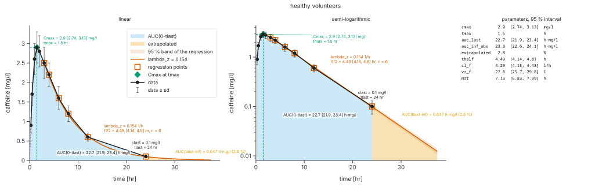

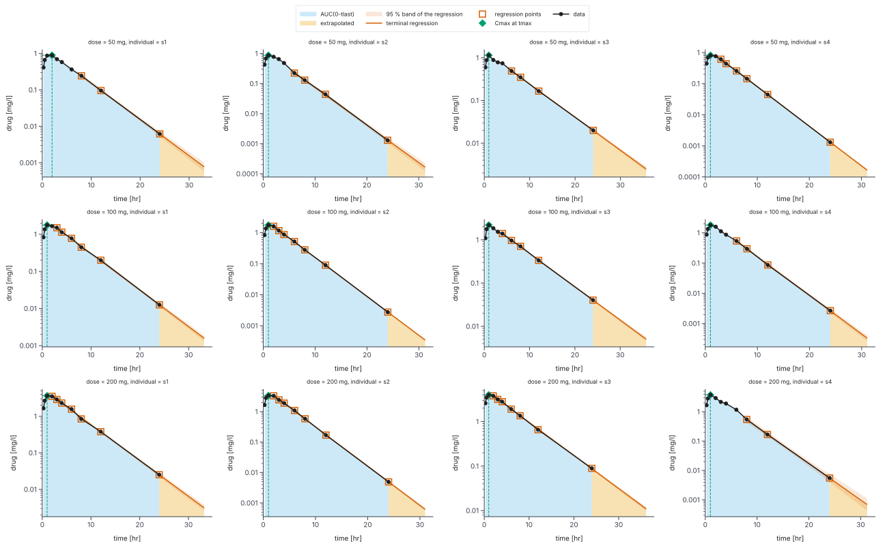

`partial` shades a named partial area of the result (`NCAOptions.partial_aucs`, see [NCA](nca.md)) over the area to \(t_\mathrm{last}\), in `style.partial_color`, with its value written into it; the interval of the area travels with the result (`NCAResult.partial_aucs`), so the name of the area is all the figure needs. The intervals are relative to the first dose of the protocol while a panel starts at the dose it analyses, so the area of a multiple dose curve is shifted onto the panel, where it lands in the interval the analysis integrated. `plot_nca_grid(partial=...)` shades it in every panel of a batch.

```python
from pkpdutils import NCAOptions

partial = nca(batch, options=NCAOptions(partial_aucs={"auc_0_12": (0.0, 12.0)}))
chart = plot_nca(
    tc, partial, partial="auc_0_12", dose=50.0, individual="s1"
)  # one curve
chart = plot_nca_grid(batch, partial, ncols=4, partial="auc_0_12")  # every sample
```

`plot_terminal_windows` shows how the terminal phase was chosen, the judgement call behind the half-life: the curve on a logarithmic value axis with the regression, the points it used and the chosen window between two dashed lines, next to the adjusted \(R^2\) of every candidate window against the time of its first point, the chosen window marked and the number of points of every window above its marker. A window starting later has fewer points, so the panel reads from left (many points, the earliest window) to right (the last three points): where the curve is flat the choice hardly matters, where it drops the terminal phase is where the last points sit. It is the diagnostic the interactive tools show (the Slopes Selector of Phoenix WinNonlin[^phoenix], the "Check lambda_z" tab of PKanalix). The analysis keeps the candidate windows only when it is asked for them, and only for a single curve: `TerminalPhase(keep_candidates=True)` writes them into the result as the point variables `candidate_t_first`, `candidate_n_points` and `candidate_r2_adj` over the dimension `candidate`. With the options the figure also draws the acceptance threshold `Acceptance.r2_adj_min` as a line.

```python
from pkpdutils import Acceptance, NCAOptions, TerminalPhase, nca_single
from pkpdutils.plot import plot_terminal_windows

diagnostic = NCAOptions(
    terminal=TerminalPhase(keep_candidates=True),
    acceptance=Acceptance(r2_adj_min=0.98),
)
windows = nca_single(tc, options=diagnostic)
r2_adj = windows.ds["candidate_r2_adj"].to_numpy()  # one per candidate window
chart = plot_terminal_windows(tc, windows, options=diagnostic)
```

`plot_terminal_windows` of the caffeine curve of `examples/nca_single.py`, whose five candidate windows all sit above an adjusted \(R^2\) of 0.998:

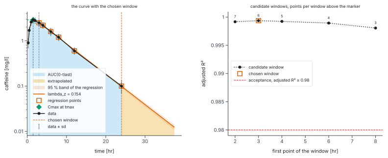

`plot_intervals` plots a per-interval parameter (`interval_*`) against the interval number, one line per sample of a batch result or a single line with `**indexers` selecting one sample; a missing (incomplete) interval breaks the line rather than raising.

```python
# not executed
from pkpdutils.plot import plot_intervals

# `ss_result`: the NCAResult of a multiple dose batch, see the steady state
# walk-through of [Workflows](workflows.md)
chart = plot_intervals(ss_result, "interval_ctrough")  # one line per sample
chart = plot_intervals(ss_result, "interval_auc", individual="s2")  # one sample
```

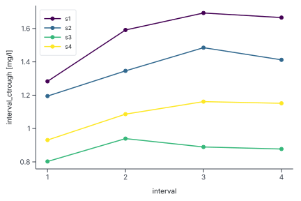

`plot_troughs` is the steady state figure of a multiple dose study: the trough of every dosing interval (`interval_ctrough`, and `interval_cmin` when the analysis reports it), averaged over the subjects of a group with its spread as error bars. `x="time"` puts them at the end of their interval, the time the trough was taken, and `x="interval"` at the interval number; steady state is where the troughs stop rising.

```python
# not executed
from pkpdutils.plot import plot_troughs

# the same `ss_result`, with an "arm" coordinate along its samples
chart = plot_troughs(ss_result, by="arm")  # mean +- sd per arm
chart = plot_troughs(ss_result, x="interval", spread="se")
```

Over a batch the title names the statistic and the dimension it was taken over (`mean ± sd over individual`); a result of a single curve draws that curve's troughs and carries no title, as in the ten dose regimen of `examples/steady_state.py`:

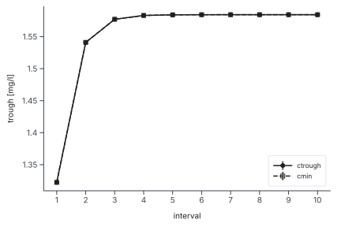

## Fits

`plot_fit` draws one sample of a [fit](fitting.md): the data with error bars when the fit had standard deviations, the fitted curve on a fine grid, the model name, the parameters as `name = value +- se` and the flags in the title, and the weighted residuals against \(x\) in a second panel below. `plot_goodness_of_fit` plots the predicted against the observed values of every sample with the identity line and the \(R^2\) per sample, and `plot_dose_proportionality` shows the exposure against the dose on log-log axes with the power fit, the acceptance wedge of the criterion and the verdict in the title.

`plot_fit` and `plot_dose_proportionality` label their axes with the names the front end of the fit stored in the result, `attrs["x_name"]` and `attrs["y_name"]`: `time` and the substance of the batch for `fit_timecourse` and `fit_timecourses`, the two column names for `fit_table`. A result built by `fit` itself carries no names and falls back to `x` and `y`.

```python
# not executed
from pkpdutils import proportionality_test
from pkpdutils.plot import plot_dose_proportionality, plot_fit, plot_goodness_of_fit

# `fit_result`, `fits` and `power`: the FitResult objects of the fitting page
chart = plot_fit(fit_result, log_y=True)  # 0-D result: no indexers
chart = plot_fit(fits, individual="s2", log_x=True)  # one sample of a batch
chart = plot_goodness_of_fit(fits, log_x=True, log_y=True)
chart = plot_dose_proportionality(
    power, test=proportionality_test(power, dose_range=(25, 400))
)
```

`plot_fit` of a Bateman fit on a logarithmic value axis (`examples/fitting_exponential.py`), of a sigmoid Emax fit with `log_x` (`examples/emax.py`) and of an allometric fit on log-log axes (`examples/covariate.py`):

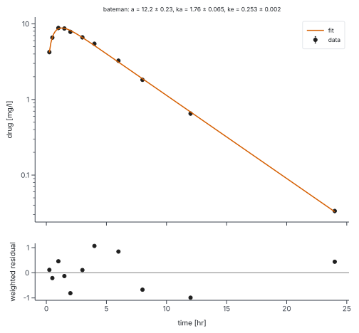

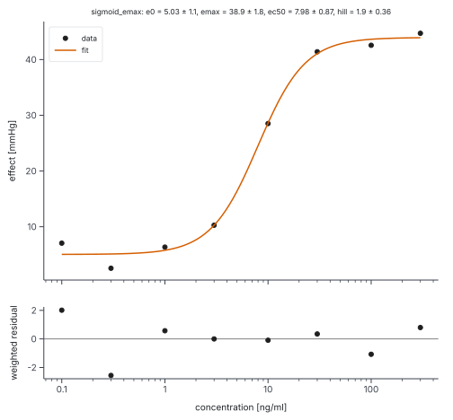

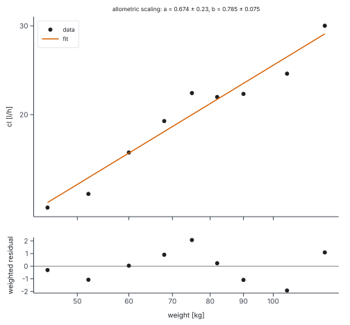

`plot_goodness_of_fit` of the same Bateman fit and `plot_dose_proportionality` of a power fit with its acceptance wedge (`examples/dose_proportionality.py`):

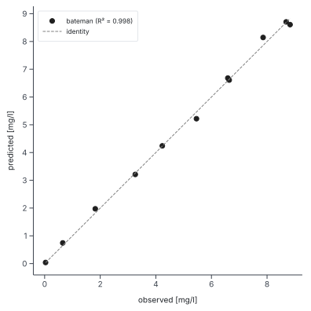

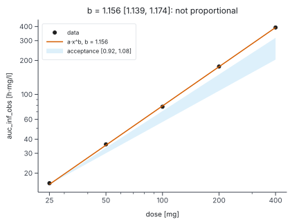

## Parameters, ratios and forest plots

`plot_parameters` draws the individual values of a parameter of a result as jittered points with a box plot per group (`by` names a coordinate along the sample dimension) and the geometric mean with its interval. `plot_ratio` draws geometric mean ratios with their intervals on a logarithmic axis against the acceptance limits of bioequivalence or the thresholds of the interaction classes, from a dictionary of `ratio` results or a `bioequivalence` result. `plot_forest` is the forest plot of a `meta_analysis`: the effect of every study with its interval and a marker sized by its random effects weight, the pooled fixed and random effects as diamonds, the heterogeneity in the title. Both write their numbers in a column to the right of the intervals (`annotate=True`, the default): `estimate [low, high]` and, in the forest plot, the weight of the study in percent. `plot_ratio` takes `labels` to give the rows the names of a publication instead of the variable names. `plot_bland_altman` shows the agreement of the predictions of a fit with the data.

```python
# not executed
from pkpdutils.plot import plot_bland_altman, plot_forest, plot_parameters, plot_ratio
from pkpdutils.stats import DDIThresholds

# `result`: the NCAResult of the snippet at the top of this page; `be`,
# `auc_ratio`, `cmax_ratio` and `meta`: the results of the statistics page;
# `fit_result`: the FitResult of the fitting page
chart = plot_parameters(result, "auc_inf_obs", "individual", by="dose", log_y=True)
chart = plot_ratio(be, labels={"auc_inf_obs": "AUC(0-inf)", "cmax": "Cmax"})
chart = plot_ratio(
    {"auc": auc_ratio, "cmax": cmax_ratio}, limits=None, thresholds=DDIThresholds.fda()
)
chart = plot_forest(meta)
chart = plot_forest(meta, annotate=False)  # the markers alone
chart = plot_bland_altman(fit_result, log_ratio=True)
```

`plot_parameters` and `plot_ratio` of a 2x2 crossover (`examples/bioequivalence.py`), `plot_ratio` against the interaction thresholds (`examples/ddi.py`) and `plot_forest` of five studies (`examples/meta_analysis.py`):

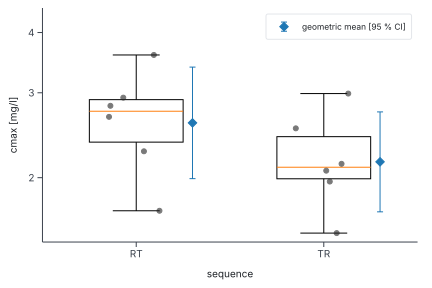

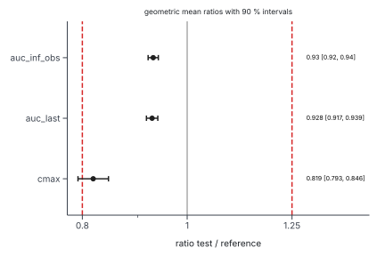

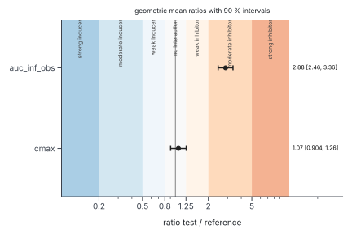

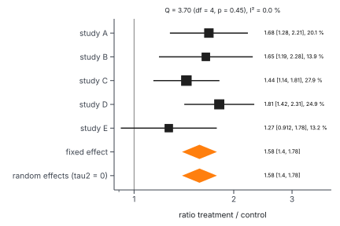

## Style

```python
from pkpdutils.plot import PlotStyle

style = PlotStyle(fit_color="tab:red", auc_color="lightgray", alpha=0.3)
chart = plot_nca(tc, nca_single(tc), style=style)
```

The reference of the module is in [API: plot](api/plot.md).

## Saving figures

Every function returns the `Chart`, and `chart.save(path)` writes it by the suffix of the path. `save_figure` writes it in several formats next to each other from one stem, `svg` by default (a vector image whose text stays text, so a journal can edit the labels), `png` (a raster image at `dpi`) and `json` (the spec of the chart, `figure/1`, which the renderer draws again):

```python
from pkpdutils.plot import save_figure

files = save_figure(chart, "figures/figure_1")  # figure_1.svg
save_figure(chart, "figures/figure_1.png", dpi=300)  # one file, by its extension
save_figure(chart, "figures/figure_1", formats=("svg", "png", "json"), dpi=600)
```

[^ich_m13a]: International Council for Harmonisation. *ICH M13A: Bioequivalence for Immediate-Release Solid Oral Dosage Forms.* 2024, 2.2.2.1. See [References](references.md#regulatory-guidance).
[^phoenix]: Certara. *Phoenix WinNonlin User's Guide: Noncompartmental Analysis*. See [References](references.md#non-compartmental-analysis).
